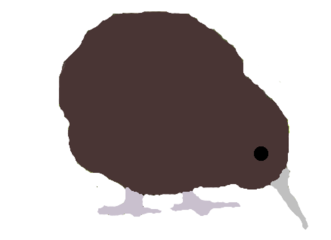

<link rel="icon" href="/favicon.ico" sizes="32x32">
<link rel="stylesheet" href="style.css">

# Welcome to Scratch-Ception, Enjoy!
This is a packaged "Griffpatch" (and an alternative "redspacecat") project: [Scratch Emulator v0.23.3](https://scratch.mit.edu/projects/113321949) & [Scratch 3 Emulator](https://scratch.mit.edu/projects/1367127226/). I did not make these projects, just packaged them with [Absoloute Mod](https://absoloutemod.github.io)/[Snail IDE](https://snail-ide.js.org). Also, Griffpatch & redspacecat respectively made their projects, i'm not Grifffpatch or redspacecat and this is unofficial. This also contains a [project by me](play/ssbu.html).
 

 

### <a href="play/index.html" style="color: #8700ff !important;">Proceed to Scratch-Ception?</a>
#### <a href="play/sc.html" style="color: #03fc1c !important;">Attempt the alternative Scratch-Ception variant?</a>
##### <a href="play/ssbu.html" style="color: #ff0000 !important;">Enter Super Scratch Bros Ultimate?</a>

